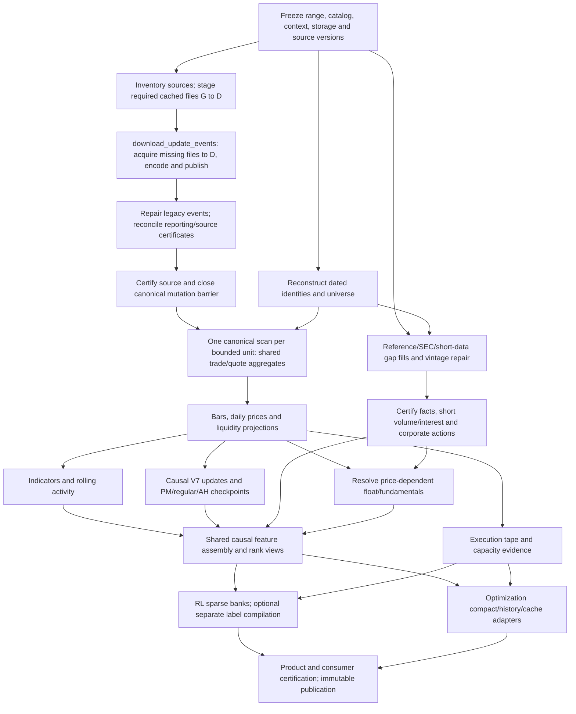

# Execution graph and shared computation

[Overview](../certified_research_dataset_design.md) · [Previous](08-optimization-inputs.md) · [Next](09a-context.md)

See runtime prerequisites, parallel branches and the outputs of each work package.

## On this page

- [Execution DAG and shared computation](#execution-dag-and-shared-computation)
- [Required execution work packages](#required-execution-work-packages)
- [Shared-batch execution example](#shared-batch-execution-example)

## Execution DAG and shared computation

### Runtime dependency graph

### When stages can overlap

Some reference facts can certify before prices; float estimates and derived ratios wait for their specific dependencies. V7, indicators and execution projections consume the same completed bounded bar/aggregate unit concurrently. Units advance as soon as prerequisites certify; do not wait for all January–October bars before starting consumers. Current global active-mutation guards require canonical mutations to finish before market writers; do not silently relax them to partition-local guards.

### ClickHouse shared computation

ClickHouse data plane: read canonical events with predicate/projection pushdown; produce reusable SSD-backed aggregate staging keyed by attempt/unit; derive rollups, liquidity, indicators and stateless histories using batched INSERT SELECT where parity is proven. Separate queries do not automatically share one CTE/in-memory result. Explicit staging prevents repeated event scans and gives restart boundaries. Consumers read sealed attempts, not partially inserted rows.

### Bounded CPU computation and data reuse

CPU plane: V7's chronological fits/pending state, consumer encoding, label compilation and account replay use bounded processes near ClickHouse, vectorized NumPy/Polars kernels and Arrow/native batches. Fetch compact inputs once per unit, not per bar/level. Share within a worker or through bounded immutable shared buffers; fan-out should not serialize a huge dataset separately to each worker. Persist V7 updates once and project consumer slots without replaying the same stream twice. Qualify those projections against the current stream.

### Chronological dependencies and resource budgets

Stateful dependencies run in order per identity across days and PM→regular→AH. Parallelize different ticker lanes, independent products and certified stateless units. Global memory/query-thread/I/O budgets cover all stages; do not sum individual scripts' maximum workers. Backpressure bounds queues and retained buffers. CPU/GPU compute, ClickHouse threads, migration mutation and G→D copies have separate measured limits.

## Required execution work packages

### Runtime work packages

| Package | Runtime prerequisites | Produces |
| --- | --- | --- |
| Plan/catalog/preflight | Code/source inventory and launch parameters | Frozen range/context/DAG/budgets and enumerated product schemas |
| Download/encode/publish | Frozen source plan, verified D cache/mount mapping, provider access | Missing canonical sources through existing updater, continuity/index/stats and source receipts |
| Canonical migration | Plan; required verified D cache | Reporting-fixed events and completed source-matching receipts |
| Historical reference reconstruction | Dated providers, ticker events, broker/SEC mapping evidence | Certified identity/universe/corporate-action intervals |
| Reference publication repair | Identity resolution, source gap fills | Public-vintage SEC, short-volume/interest and related facts |
| Shared aggregate/core build | Certified events/universe, no active mutation, compatible prior state | Bars, daily prices, liquidity and reusable intermediate aggregates |
| Indicators/market histories | Shared bars and declared prior context | Indicators, RVOL/rolling state and session-start market state |
| Causal V7 and session backfill | Bars, compatible predecessor, splits | Causal updates/projections and PM/regular/AH full state |
| Float/derived fundamentals | Certified facts, prices where required, actions | As-of share-supply/fundamental intervals and boundary views |
| Execution materialization | Aggregate/liquidity/price-level evidence; tick/scenario authority | Indexed reusable execution shards |
| RL and optimizer adapters | Required certified products above | Sparse banks, optional labels, compact/history/cache exports |
| Final publication | All required unit/product receipts and parity checks | Immutable dataset registry and downstream compatibility certificates |

### Persistence prerequisites

Compact-schema/reader acceptance is a prerequisite for persistence in every package: select tested codecs/layouts and certify round-trip/random-access behavior before a full-range writer starts. Acquisition also contributes raw staging, canonical growth and encoding/merge temporary space to admission budgets.

## Shared-batch execution example

For a bounded listing/day batch, certify its event inputs, aggregate those events once, and publish the shared bar/quote unit. Indicators, V7 and execution projections may then process that unit concurrently. The next listing batch can be queued while these consumers finish, subject to the global memory budget. A ticker's next day still waits for its required predecessor state.

The reusable intermediate is explicit: three independent SQL queries do not automatically reuse the same calculation. It must be materialized or held in a deliberately shared bounded buffer.

[Overview](../certified_research_dataset_design.md) · [Previous](08-optimization-inputs.md) · [Next](09a-context.md)
