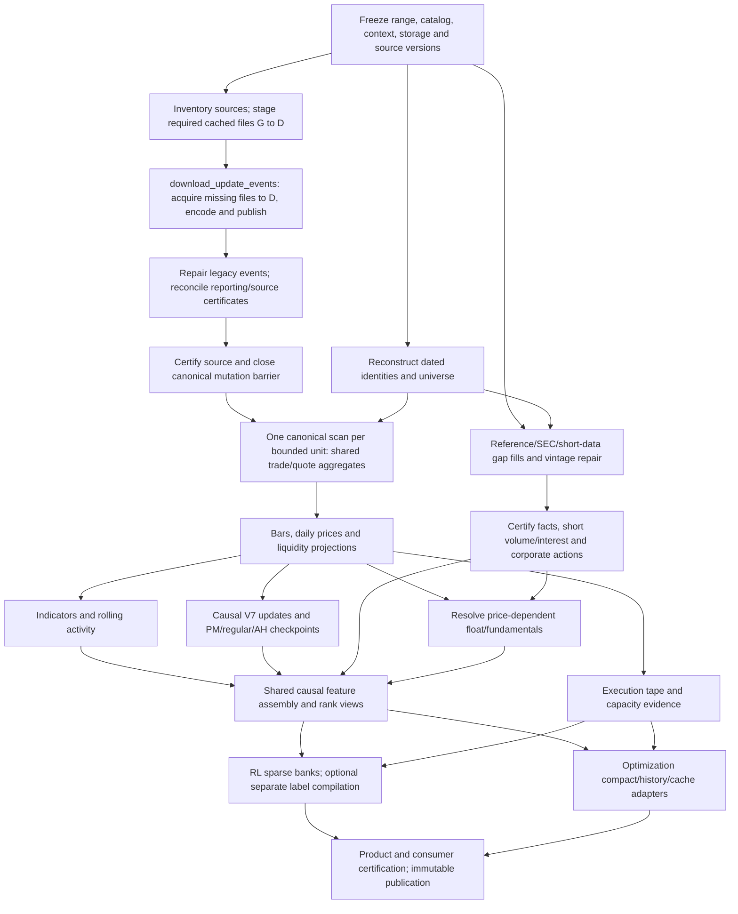

# Certified research dataset: RL trading and strategy optimization

Design date: 2026-10-11. Status: proposed implementation contract; no campaign is authorized by this document. Target: January 2026 through the last fully certified canonical source session, with separately planned prior context. The October 11 audit resolves that endpoint to October 2, 2026 (189 exchange sessions). A later launch must resolve and freeze its endpoint again.

## 1. Outcome and scope

Produce one immutable, identity-keyed certified market/reference set, with versioned adapters for current RL V6 and vectorized optimization V6/V7. Consumers should load prepared inputs, rather than reconstruct fundamentals, stream yesterday's PM/regular bars to start AH, or repeatedly query events during training/search.

This is an execution dependency design, not a code-development schedule. Common expensive inputs are calculated once, then independent consumers run concurrently. Certification is product-specific: source integrity, causal feature correctness, model-ready compatibility and modeled execution are separate claims. Certified inputs do not certify profits or actual broker fills.

Approved decisions from this conversation:

- Reject unknown/invalid reporting clocks and delayed trades from every affected price, volume, count, VWAP, execution and structural product. Preserve canonical events and rejection evidence.
- Retain the existing greater-than-10-second delayed threshold and explicit delayed-condition rules. No evidence reviewed supports changing the threshold.
- Research availability means original public availability, not when this app downloaded a record. Original vintages and revisions must support that claim.
- Produce causal PM, regular and AH V7 checkpoints; retain retrospective labels separately.
- Derive context from launch parameters and feature requirements. Events back to 2019 and checkpoints from 2025 are potential inputs, not automatically compatible seeds.
- Define the full output catalog and dependencies before implementation. Copy required SIP migration files G to D SSD through the ingestion-owned path.
- Integrate `pipelines/market_sip/flatfiles/download_update_events.py` as the acquisition/encoding/publication stage, so the same launcher manages missing earlier sources and future updates.
- Every durable schema must declare compact encoding, lossless compression, partition/order keys and append/backfill behavior before implementation; dense expanded caches are optional bounded accelerators.

No training, search, sealed evaluation, monitor restart, deletion or deployment is part of preparing this design. Existing unrelated changes and immutable research artifacts remain intact.

## 2. Review evidence and current gaps

Code reviewed: market-day SQL and reporting migration; Reference Gateway tradability, publications and float resolution; SEC as-of queries and app fundamental formulas; structural V7 campaign/stream; RL V6 source, feature bank, current label/sequence contracts; optimization V6 history and V7 inputs/cache. TASK-0220 and TASK-0223 continuity was checked. Version names require care: structural V7 is not optimization V7; `structural_checkpoint_campaign_v7.md` describes another generic-structure campaign and is not the Level Book V7 contract.

Live reads were bounded, read-only ClickHouse queries on October 11. Evidence is under `D:/TradingML/runtimes/market-data-expansion-review/20261011/`; no secrets are included. Earlier audit results below are from this conversation's October 11 investigation; new reference checks are in `design_*.json`.

| Authority/product | Available evidence | Consequence |
| --- | --- | --- |
| Canonical SIP | Source receipts for Jan 2–Oct 2: 189 sessions, 120,294,226,954 events, 25,995,919,023 trades | Use certified canonical events; distinguish NY session date from physical UTC partition dates |
| Reporting classification | 56 complete receipts July 1–Sep 18 in the earlier audit; sampled older rows unclassified | Audit/certify or migrate remaining days; do not mutate days that are already correct just to obtain a receipt |
| Existing core products | 36 sealed sessions July 30–Sep 18; sampled certified bars admit unknown clocks under the old policy | New strict eligibility/build lineage; recompute affected state chains and consumers |
| Universe snapshots | No V2 snapshots before July 30; gaps/carry-forward cases later; retained V1 publications do not cover January | Required dated historical reconstruction; today's graph is insufficient |
| Structural history | 2025–Sep 2026 history exists but earlier audit labels most coverage legacy-unfiltered | Compatibility audit before reuse; incompatible seeds require prior repair/rebuild |
| FINRA short volume | 3,143,402 rows, 188 dates Jan 2–Oct 1, CNMS; all publication timestamps null; 1,027,798 rows have empty security identity | Fill endpoint gap, repair dated identities and availability; dates alone do not establish certified coverage |
| Massive short interest | 142,612 rows for 11 settlement dates Jan 15–Jun 15; all publication dates/timestamps null; 23,666 empty security identities | Gap-fill later periods and certify publication timing before historical use |
| Resolved float | 60,424 rows across 9 resolution dates Sep 23–Oct 5 | Not target-period historical authority; raw float observations exist earlier and must be resolved as-of |
| SEC XBRL | Tables/columns exist; physical parts contain 57,063,756 rows / 7.664 GiB | Physical rows are not unique certified facts. Whole-table FINAL aggregate exceeded the 1 GiB read budget; all-issuer historical coverage remains unproven |
| Optimization feature cache | Current `v7/feature_cache.py` and `prepare_features.py` exist with hashed, resumable tiles | Reuse/upgrade compatibility; the older handoff saying persistence is absent is superseded by current code |

Reference parts checked reside on `live_market_ssd`. Raw-source completeness, dated identity coverage, publication vintages and algorithm compatibility still need per-unit certification; an aggregate row count cannot establish them.

## 3. Common identity, clock and certification contract

All products bind `dataset_id`, schema/algorithm/policy hashes, canonical source receipts, universe revision, context plan, calendar revision and code commit. Names below describe proposed logical products, not tables already implemented.

Keys: issuer/CIK for issuer facts; security ID for share class; listing ID for exchange/broker scope; symbol intervals for ticker lookup. Never join historical records solely on today's ticker. Certificates enumerate required session × listing × product units, with complete, covered-empty, unavailable, conflicted, blocked and failed outcomes. Missing records are never converted into zero values or empty certificates.

Times are UTC integer microseconds or timezone-aware DateTime64; session dates/boundaries use America/New_York and a pinned exchange calendar. Keep these distinct:

- Market event availability: canonical SIP clock and ordinal ordering. Delayed participant time is classification evidence, not permission to reorder history.
- Measurement/effective time: what period a fundamental or short position describes.
- Public availability: when the original record could first be used.
- Local ingestion and certification times: operational provenance, not historical knowledge.
- Revision availability: when corrected/restated information supersedes a prior version.

Date-only publication evidence must not receive an invented exact timestamp. A documented conservative bound may be certified with precision/reason metadata; otherwise the value is unavailable for intraday use. A later restatement cannot replace an earlier vintage before its publication. Reconstructed research availability is named separately from app-observed/live availability.

Prices retain scaled-integer authority; share sizes and notionals retain source precision. Float32 is a model representation, never the threshold/count authority. Every numeric model field has validity, availability and provenance; invalid values are masked, not silently forward-filled into observed trades.

## 4. Data catalog and prepared forms

### 4.1 Canonical events and ingestion repairs

Authority: `market_sip_compact.events_YYYY`, source-day stats and reporting coverage. Maintain full quote/trade lineage, ordinals, price/size scales, condition eligibility, reporting state and source hash. Canonical quote handling is separate from the trade reporting gate.

The ingestion entry point is `pipelines/market_sip/flatfiles/download_update_events.py`. Its current code supports remote discovery or explicit start/end source dates, bounded download workers, compact encoding/ClickHouse insert, continuity checks, sampled raw-to-encoded audits, ticker/day index and source-day statistics. New imports compute reporting flags. An updater `ok` manifest is not sufficient by itself to satisfy downstream reporting coverage: reconcile/publish the source-matching reporting receipt required by market-day consumers.

At plan time classify each source day: already certified and reusable; imported but requiring reporting/provenance repair; cached but not imported; or absent and requiring remote acquisition. Reuse certified days without re-reading retained raw files. Copy required existing G files into verified D cache; configure fresh downloads and ClickHouse file paths to that D cache. Validate Windows/UNC and ClickHouse mount paths refer to the same files. Download/import missing sources, certify encoding and source receipts, then run applicable legacy migrations. This ingestion-owned path is the only raw-file consumer.

The updater also builds legacy macro/daily-session bars by default. For this unified campaign use its existing `--skip-bars` mode when the shared strict-policy producer owns all derived products. Its current daily-session identity/quote-fallback behavior is not automatically equivalent to the new research price contract. Reuse compatible daily products only after explicit parity/source checks. Do not publish two competing daily-price authorities.

Audit optional execution-clock sidecar ownership separately: the current updater DDL passes the common storage-policy argument to its clock sidecars too. Integration must enforce the appropriate explicit workload policy for each table and verify actual parts; one global storage-policy override is not proof that all source and operational products are correctly placed.

Never enable `--force-day-delete` or rebuild-existing deletion flags by default. Existing-source repair requires a separately planned restart-safe migration and lineage invalidation. Earlier imports must respect yearly ordinal continuity, not merely insert rows into an older date partition; audit updater support before permitting earlier-range extension. An ordinal-changing canonical migration invalidates indexes/sidecars and descendant receipts. Encoding/schema evolution must be versioned without reinterpreting old bitfields.

The new shared trade gate requires the timely classification, valid reporting provenance and ordinary product-specific condition eligibility. Current reporting bits encode timely as `(event_meta & 0xC0) == 0x40`; delayed, unknown and invalid combinations fail. Current rules include conditions 5/13/30/31/32/33, prior NY reporting date and lag greater than 10 seconds. Missing, zero or inconsistent/future participant clocks must not escape as timely. Classification and aggregation eligibility are separately hashed.

Preserve counts/notional/volume by rejection reason, source date and unit. Existing five-condition archival limitations remain explicit; required missing provenance needs a versioned ingestion migration/sidecar, never a derived flatfile fallback.

### 4.2 Historical universe and reference dimensions

Forms: immutable dated identity/listing intervals; broker-conid evidence; pre-open membership certificates; small per-session listing dictionaries; corporate-action intervals; session calendar.

Reference Gateway publication currently requires active listing and symbol, positive conid, USD, US exchange, non-OTC venue, supported STK/STOCK/STOCKS, durable issuer identity, no duplicate durable issuer identifier and no open mapping issues. Contract resolution also enforces compatible unique contracts and exchange/security identity evidence. Reconcile predicate differences between graph admission, universe publication and consumer scope before freezing one shared rule revision.

Build the historical listing census from dated source evidence, symbol/event intervals and listings including delisted securities. Resolve provider/SEC/broker identities and apply rules on the corresponding date. Current conid evidence may establish a mapping only with explicit validity evidence; do not claim historical broker execution eligibility from conid existence alone. Unresolved cases remain visible and block strict membership certification. IPOs, delistings, OTC transfers, relistings, symbol changes and share-class changes require distinct intervals.

Do not filter context using today's universe. A ticker admitted during the target range may need older bars under its prior symbol/listing identity. Preserve competing or unresolved mappings instead of picking the first match. Reference Gateway ticker-event history already exists: inspect its coverage and reuse it rather than blindly redownload it.

### 4.3 Shared bars and activity

Authority/form: versioned ARTE-style sparse bars keyed by build/attempt, session, listing and resolution. Current market-day frames are 100 ms, 1 s, 5 s, 10 s, 30 s, 1 min, 5 min and 1 hour. Include OHLC, notional, volume, trade count, execution-specific volume/notional and validity. Publish session/regular daily summaries needed by float, prices and prior-close consumers with explicit source bindings.

Preserve price-valid, extrema-valid and activity-only rows. No-trade clocks do not become synthetic price candles. Cumulative session VWAP and rolling activity reuse the same certified aggregates. Daily summaries declare PM/regular/AH scope and adjustment basis. Split-adjusted model views retain original unadjusted data and adjustment evidence.

### 4.4 Technical indicators and market histories

Current SQL catalog: EMA 7/9/12/15/20/26/50, MACD 12/26/9 including histogram, RSI14 and ATR14 at supported frames, with readiness flags. EMA/MACD carry certified predecessor state; existing RSI/ATR session reset semantics remain versioned. A request for alternative periods/resolutions produces a new declared product, not an execution-time substitution.

Forms: sparse indicator rows aligned to eligible bars; scalar session-boundary state; rolling-activity/RVOL summaries; optimizer history banks. Current RL uses same-clock prior-session 10-second RVOL, not an assumed 20-session default. Additional RVOL windows are launch parameters. Cumulative/session extrema, VWAP and rank state must have declared reset/carry semantics.

Optimizer's 332 history channels comprise trailing recent highs (1–60), lagged closes (1–60), attention/notional means (1–60), average moves (2–32), and 121 confirmed swing-low combinations from windows 1/2/3/4/5/10/15/20/30/45/60. Preserve elapsed-second gaps and confirmation clocks. Do not substitute observed-candle windows.

### 4.5 Quotes and execution evidence

Forms: certified 100 ms liquidity rows; sparse quote updates with timestamp, bid/ask and size; execution-price/price-level capacity evidence; next-observed-trade lookup; terminal marks. Quote snapshots retain age, freshness and invalidity. V7 optimization currently uses latest causal second-close snapshots, with quotes older than one second invalid; this is not bid/ask OHLC.

Detailed RL/optimization V6 execution needs fresh arrival quotes, extrema and passive-target price-level volume. Displayed size and price-level volume are modeled optimistic bounds, not queue-position evidence. Reuse canonical aggregation/intermediate projections where sufficient. If exact price-level evidence requires another canonical pass, materialize it once and disclose that measured exception to the single-read objective.

Prepare a reusable indexed execution tape for the selected range; current RL environment reads submitted/held-ticker evidence lazily. Add an offline adapter so repeated PPO runs can use certified indexed shards without per-step database round trips. This adapter preserves arrival/freshness/partial-fill semantics; it does not replace execution evidence with 1-second candle volume.

Historical tick-size rules and instrument/LULD tiers require dated, versioned evidence. Current `v6/luld.py` explicitly implements modeled research bands/pauses, not official SIP halt/band evidence. Record the modeled scenario contract separately; require official dated halt/LULD sources if a use case requests authoritative execution restrictions. Do not infer historical tick size from observed price decimals.

### 4.6 Structural Level Book V7

Forms: normalized causal level/observation updates; lookup projections; full resumable checkpoints at PM close, regular close and AH close; coverage/predecessor receipts. Retrospective full-day labels are a separate, clearly named output.

The historical Level Book campaign uses whole-day range/noise in fitting parameters. It cannot produce causal intraday state simply by saving its intermediate values. Use the causal streaming kernel and prefix-only parameter selection for the new checkpoint family. Preserve existing pre-04:05 trade exclusion unless a separate approved structural policy changes it.

Standard boundaries are 09:30, calendar regular close (normally 16:00), and supported AH close (normally 20:00 ET). Use half-open input ranges and completed bucket availability. Checkpoints retain pending reactions, observations, fits, roles, armed state, counters, source cursor, parameters, predecessor hash and split evidence. Day rollover/split adjustment occurs once, not at every session restoration. Empty segments carry valid state with explicit coverage.

New history: prior AH → PM → checkpoint PM → regular → checkpoint regular → AH → checkpoint AH. Backfill: compatible prior AH → shared PM/regular bars → same kernel → missing PM/regular checkpoints. Preserve existing AH unless equivalence proves reuse; old retrospective/legacy state is not an acceptable causal shortcut. Repair/rebuild prerequisite state first when incompatible. Consumer constructors currently requiring a prior-date seed need explicit same-day full-state restore support.

Regular-close V7 state alone does not initialize AH research: indicator, VWAP/extrema, rolling activity/rank and relevant market state need compatible session-start sidecars too. Account/positions/order state belongs to a scenario-specific replay checkpoint, not universal market data.

### 4.7 Certified fundamentals and short pressure

Primary form: long-form change/vintage records and validity intervals, not one copied row per second. Fields include metric ID, value/unit, issuer/security/listing scope, fiscal/measurement period, public availability/precision, revision, source hash/accession, calculation version, confidence, age and missing/conflict reason. Publish batch as-of projections plus pre-open/PM-close/regular-close/AH-close views. Intra-session public updates remain available through intervals; boundary snapshots are not the sole authority.

| Family | Required prepared outputs | Dependency/qualification |
| --- | --- | --- |
| Share supply | Reported float, eligible SEC-estimated float, outstanding shares, lower/upper bounds, weighted basic/diluted shares, issued/authorized shares where reported | Dated identity, original fact/provider vintages, splits; estimate additionally needs measurement-date canonical price |
| Short volume | FINRA CNMS short/exempt/non-exempt/total volume; short-volume ratio; prior-publication value; 20-session summary and configured rolling windows | Daily publication, dated mapping, matching FINRA denominator and coverage; never substitute total SIP volume |
| Short interest | Short shares, settlement date, publication date/time, provider ADV/days to cover; short-interest/float with compatible share basis | Public release evidence; float ratio additionally needs qualified as-of float |
| SEC reported facts | Full current app US-GAAP/IFRS catalog described below, with original tags/units/periods | Original filing vintage, availability, entity bridge, taxonomy and period reconciliation |
| Derived fundamentals | Existing 19 metric formulas below; market cap/share-based turnover where valid | All constituent values available, comparable periods/units and declared share-class basis |
| Related existing reference data | SEC fails-to-deliver, exchange Reg SHO threshold status, splits, dividends, IPO metadata and dated classification/country | Include typed coverage/availability; source timing repair required before causal use |

SEC catalog baseline is the union of `ticker_facts_service.FUNDAMENTAL_TAGS` and SEC/share dimensions in `security_dimensions.py`: revenue, gross profit, operating/net income, basic/diluted EPS, operating cash flow, capex, cash, current assets/liabilities, receivables/payables/inventory, assets/liabilities/equity, current/noncurrent debt, R&D, SG&A, stock compensation, interest/tax expense and effective tax rate, goodwill/intangibles, deferred revenue, debt issued/repaid, equity issuance, outstanding/weighted shares, SEC public float, dividends and repurchases. Freeze every tag alternative, unit, duration/instant rule and formula into an enumerated machine-readable catalog before coding. Today's UI selector is not itself a historical certification authority.

Existing derived metrics: free cash flow; gross/operating/net/FCF margins; ROA/ROE; working capital; current ratio; debt/equity; net debt; interest coverage; revenue/earnings/basic-share growth; dilution spread; cash conversion; R&D and SG&A intensity. Preserve current approximation labels, period alignment and invalid-denominator rules. Financial-strength scores remain separately versioned derived heuristics, never reported facts. Market cap cannot indiscriminately multiply one listing price by issuer-wide shares; require compatible class basis or a dated reported snapshot.

Float resolution reuses provider-first logic, qualified SEC public-float estimation, outstanding-share upper bound, then unavailable. `EntityPublicFloat` is USD market value, not shares. Estimated float requires measurement-aligned unadjusted regular price, applicable known splits, unique issuer/class bridge, acceptable age, and consistency with outstanding shares. Multi-class allocation is unavailable without evidence; an upper bound is not an actual float. Preserve reported/estimated/upper-bound/unavailable and conflict states.

Current gaps: FINRA importer sets publication time null; short data feature SQL falls back to trade/settlement dates; scanner static publication selects latest short records without historical availability; historical loaders use a ticker lookup; float resolution is EOD/ingestion-gated and replaces dated partitions. SEC queries also filter local recorded time. Replace these behaviors in a new research contract, preserving old operational products. Do not merely remove ingestion filters: certify original vintages, original-publication bounds and revisions. Unknown publication times block causal value use; source calendars may provide conservative bounds only with verified evidence.

FINRA volume describes disseminated trades reported to FINRA facilities, not all-exchange short volume or outstanding short positions. Preserve CNMS scope and avoid double-counting consolidated/component files. See [FINRA notice](https://www.finra.org/sites/default/files/2019-07/information-notice-051019.pdf).

Short-volume daily ratio is short volume / matching FINRA total volume. The existing 20-observation summary uses sum(short volume) / sum(total volume), not the mean of daily ratios. The certified version records window dates, eligible publication cutoffs, expected/observed session counts and coverage; partial windows have their own readiness state. Provider days-to-cover remains reported; a recalculated value is a distinct metric using a declared certified ADV window. Short-interest/float and volume/float turnover require positive qualified float, matching security/share basis and as-of availability; upper bounds cannot supply exact ratios.

### 4.8 RL V6 consumer forms and upgrades

Current authority is `LABEL_PREPARATION.md` and `TEACHER_SEQUENCE.md`, which supersede legacy numbered portfolio preparation. Current dataset/algorithm versions must be pinned from those contracts at launch, not inferred from a README's older examples.

- Sparse identity-packed bank: int64 close clocks, `[actual_rows,37]` float32 scalars, `[actual_rows,2,5,11]` V7 slots, identity offsets, masks and hashes. Store each actual row once; loaders form 120-actual-candle histories with prior tails. Preserve activity-only invalid-price rows.
- 37 scalars currently cover OHLC, bar/session VWAP, activity and 60-second sums, prior-session RVOL, MACD/RSI/ATR/EMA, clock/session/gap, float/outstanding/split ages and validity. Ten V7 slots contain relative geometry, counts, confirmation age, role/origin and presence.
- Separate immutable 1a opportunity and 1b selected/grouped/suppressed label shards, allocation/forecast/horizon targets and audit evidence. Strict-prior observations exclude the target candle (`close_us < t`). Future gains, grouping/allocation denominators and outcomes remain target-only.
- Existing episode admission uses prior 60-second evidence: ≥20 trades, ≥2,000 shares, ≥10 active seconds and prior-trade age ≤5 seconds. Later >5-second inactivity invalidates hindsight supervision, not causal observations. Thresholds use exact certified activity, not float32 bank fields.
- PPO trajectories are policy/scenario-specific: account and holding observations, sampled proposals, actual modeled execution, rewards, log probabilities, termination/truncation, elapsed time and next state. They cannot be universal precomputed labels. The PPO critic needs returns from its continuation policy, not the teacher's future price gain.

Required upgrades: strict-unknown build gate; dated universe adapter instead of current static canonical scope; certified as-of reference adapter instead of raw ingestion-filtered float reads; compatible causal V7/session restore; indexed offline execution evidence; tick/LULD scenario evidence; new bank/label publication hashes after repaired bars. Retain current missing-V7 masking only where its certificate explicitly permits genuine absence; malformed/incompatible state must not masquerade as absence. A preset requiring levels must certify their presence or proven empty state.

Broader fundamentals and short-pressure values are prepared as a sidecar now. Do not silently expand the existing 37-scalar model or reuse checkpoints under a different shape. Their adoption requires a versioned feature/model adapter and training-only normalization, with age, precision and confidence channels.

### 4.9 Optimization consumer forms and upgrades

Preserve separate execution assumptions: V6 detailed broker/account replay versus V7 assumed fractional fills at next observed trade close. V7 quote features are not fill constraints. Terminal mark, missing-price and held-after-ranking behavior remain explicit.

Forms: compact per-session Parquet market/rank tapes; mmap clocks/identity maps/features/validity; original 149 feature channels (147 bank features plus split/session flags); 332-channel lossless history banks and elapsed-clock indices; relative-price channels and 11 quote/price/activity channels; feature-cache tiles; execution evidence for V6. Prepare full histories for the ranked-union identities before and after rank entry. Preserve price-filter-before-volume ranking and held identities after rank exit. Full-universe common data must not be reduced to a fixed top10 upstream.

Current cache already supports 2048-clock/four-listing compressed tiles, packed validity, source/schema/implementation hashes and restart. Integrate it as a consumer materialization, not a new event fetch. GPU may use compact resident banks/gathers while CPU uses tiles; avoid mandatory duplication when a chosen adapter does not need both. New source/eligibility/universe/feature contracts invalidate old compatibility even if file shapes match.

Add certified fundamentals/short-pressure sidecar and versioned searchable channels only through an explicit catalog revision. Preserve temporal rule semantics, source masks, 121 swing combinations and quote age. History/source compression must be lossless; rank/filter parameters are in the receipt. No research financial qualification, evolutionary launch or reopened sealed set is implied by data certification.

### 4.10 Existing derived features and optional extensions

Catalog existing candidate/admission, HOD, pivot, executable-price and strategy-facing V7 projection products discussed in this chat. Where current consumers require them, regenerate them from the shared strict-policy source and certify their dependencies; do not assume core bars imply coverage of these products. Preserve generic market features separately from strategy-specific admission policies. A narrow candidate funnel cannot remove symbols needed by a broader RL/optimization rule search.

Ranking views include the declared price filter, rolling dollar/share volume window, tie-breaking and eligibility clocks. They are consumer-configured projections of the full certified population. Prepare cumulative extrema/VWAP and rank context once for identical contracts; different windows/policies get distinct hashes. For RL strict-prior target t, joins stop before t; optimizer second-close observations can include completed information through that close. One adapter cannot silently apply the other timing convention.

News/SEC narrative synthesis, embeddings, borrow inventory/rates and book-depth data are not current mandatory inputs demonstrated by these consumers. Record them as explicitly optional catalog extensions with independent authorities, availability and coverage. Existing UI narratives or current-only snapshots must not be promoted to certified training features. Encoder future-return pretraining, if selected later, gets separate masked target shards; those targets are not the PPO critic or causal observations.

## 5. Execution DAG and shared computation

Some reference facts can certify before prices; float estimates and derived ratios wait for their specific dependencies. V7, indicators and execution projections consume the same completed bounded bar/aggregate unit concurrently. Units advance as soon as prerequisites certify; do not wait for all January–October bars before starting consumers. Current global active-mutation guards require canonical mutations to finish before market writers; do not silently relax them to partition-local guards.

ClickHouse data plane: read canonical events with predicate/projection pushdown; produce reusable SSD-backed aggregate staging keyed by attempt/unit; derive rollups, liquidity, indicators and stateless histories using batched INSERT SELECT where parity is proven. Separate queries do not automatically share one CTE/in-memory result. Explicit staging prevents repeated event scans and gives restart boundaries. Consumers read sealed attempts, not partially inserted rows.

CPU plane: V7's chronological fits/pending state, consumer encoding, label compilation and account replay use bounded processes near ClickHouse, vectorized NumPy/Polars kernels and Arrow/native batches. Fetch compact inputs once per unit, not per bar/level. Share within a worker or through bounded immutable shared buffers; fan-out should not serialize a huge dataset separately to each worker. Persist V7 updates once and project consumer slots without replaying the same stream twice. Qualify those projections against the current stream.

Stateful dependencies run in order per identity across days and PM→regular→AH. Parallelize different ticker lanes, independent products and certified stateless units. Global memory/query-thread/I/O budgets cover all stages; do not sum individual scripts' maximum workers. Backpressure bounds queues and retained buffers. CPU/GPU compute, ClickHouse threads, migration mutation and G→D copies have separate measured limits.

## 6. Context planner

The planner resolves each dependency into ranges/seed requirements, takes their union and records why each prior unit is needed. Context-only units have no training labels or objective trades. Launch parameters specify lookbacks, resolutions, indicator periods, session start, ranking windows and selected consumer adapters.

| Requirement | Planned context |
| --- | --- |
| RL 120-row observation | 119 prior actual rows plus current causal history; absence carries masks, not invented candles; resolve beyond one session only under the declared adapter contract |
| Current RL RVOL | Exact prior trading session's same-clock volume; additional selected baselines add their explicit session windows |
| Optimizer histories | Elapsed-clock window/confirmation dependencies, full ranked-union advancement and prior bank tail; model boundaries stay unchanged |
| EMA/MACD | Compatible predecessor state per frame/identity, or explicit bootstrap/rebuild origin; arbitrary 60/90-day truncation is not exact equivalence |
| V7 | Latest compatible causal predecessor and required retained observations; incompatible 2025 seed requires rebuild of its dependency prefix |
| Fundamentals | Last eligible fact before range plus updates and required comparable periods; float resolver's existing 520-day eligibility is a versioned rule, not universal fact retention |
| Float price/splits | Measurement-date price window (current resolver up to seven days) and intervening known corporate actions |
| Short data | Last public observation before start plus rolling-window inputs; settlement/trade date alone is insufficient |
| Session-only replay | Prior boundary market-state checkpoint and any declared causal history; fresh account state or separately certified scenario checkpoint |

Events available from 2019 are not a mandate to rebuild every product from 2019. Planning first tests compatible seeds and sparse dependency queries. Fail/report if source bounds cannot satisfy a required dependency. Proven-no-prior-history bootstrap differs from missing history.

## 7. One launcher and restart model

Proposed single entry point exposes `plan`, `run`, `resume`, `status`, `verify`. This is an interface proposal, not an existing runnable command. Resolve configuration once and freeze a content-addressed plan.

The controller wraps the existing updater rather than implementing a second downloader/encoder. It maps the frozen source range and D cache/mount roots, resource limits, explicit `sip_raw_ssd` storage policy and `--skip-bars` to that stage. Modes distinguish reuse-only, acquire-missing and explicitly planned canonical repair. Automatic remote discovery may propose new dates, but execution freezes fully published source days first; an updating provider frontier must not change a running dataset. Completion resumes from verified source-day receipts, not a downloader exit code.

Configuration groups: target/context ranges; use-case presets and metric catalog; session checkpoints; source/universe/public-availability policy; G archive and D cache roots/hydration mode; machine/runtime root; global resource budgets; disk headroom; retry bounds; split roles and consumer export options. Strict unknown exclusion is fixed in this dataset revision, not a convenient opt-out. Defaults are complete and safe; ambiguity blocks planning.

Hydration inventory includes context migration files. Existing reporting tool supports verified temporary copy, hashes, atomic publication and mismatch rejection. Canonical SIP flatfiles may be opened only by the ingestion-owned migration/import path. If all files cannot stage within D headroom, fail or explicitly plan bounded staging tranches. Never overwrite mismatched files or delete caches/old products without authorization.

Canonical/operational data uses designated `sip_raw_ssd` / `live_market_ssd` policies; `default`/`hdd` backup routing is forbidden. Verify table policy and actual parts before writers, after writes and at certification. Runtime arrays, receipts, logs and caches stay under machine-specific `D:/TradingML/runtimes`.

Progress is dependency-aware: queued/active/reused/certified/empty/unavailable/blocked/retried/failed, counts, current unit, throughput and measured ETA. Redirected logs use plain summaries. Ctrl+C cancels owned read queries, drains workers, records uncertain writes/mutations and retains restart receipts. A server mutation may outlive its initiating process: resume reconciles it before continuing. Ownership locks prevent overlapping writers; source changes invalidate descendants through the state chain. Idempotency uses attempt IDs and verified publication, not blind repeated INSERT.

## 8. Certification and acceptance

Certification requires source counts/hashes and ordinal continuity; source-matching reporting receipts; storage placement; dated identity uniqueness and membership coverage; availability/vintage proof; no duplicate keys; sparse-row validity; frame/bucket boundaries; split basis; predecessor hashes; declared missing/conflict outcomes and output hashes. Product completeness is relative to an enumerated required catalog, never merely successful exit codes.

Representative acceptance: dense/sparse/quote-only listings, IPO and symbol transition, split/reverse split, early close, no-trade segment, delayed/unknown/invalid clocks and publication revisions. Compare shared gates across price/volume products and exact activity thresholds. Verify rolled bars against the base aggregate and indicator state across days. Restore at PM/regular/AH and compare continuous V7 state/output hashes; compare new producer and backfill; append future bars and prove earlier causal checkpoints unchanged.

Check original filing/short-data publication boundaries and conservative date-only handling. Prove unchanged pre-publication values when later revisions arrive. Audit missing identities against dated census and prevent survivorship filtering. Compare new consumer adapters to existing clocks, shapes, masks, rank behavior and independently calculated outputs. Verify offline execution reads against pinned database evidence, including freshness/arrival clocks and passive-target capacity.

Immutable splits: preserve existing RL and optimization training/development/sealed authorities. Current RL documentation seals Aug 26/Aug 31/Sep 2; optimization history seals its own validation dates. These assignments are separate, not interchangeable. Common mechanical preparation does not authorize reading sealed labels, computing selection metrics or changing splits. Holdout materialization requires an explicit permitted production protocol and access-controlled role; otherwise record deferred units. Normalization/calibration fits use training only.

Three milestones: (1) common market/reference certification; (2) RL-compatible banks plus separately certified labels if selected, and optimizer-compatible compact/history/cache artifacts; (3) detailed replay/financial qualification in a separately authorized task. Never present milestone 1 as finished model-ready delivery if an adapter dependency is missing.

## 9. Storage and measured capacity

### 9.1 Mandatory compact persistence contract

Compression and compaction are schema requirements across canonical, intermediate, checkpoint, model-ready and certification layers. Lossless compression does not justify lossy price/volume rounding, dropping masks or shortening history. Physical MergeTree part merging is distinct from logical deduplication; neither changes the declared authoritative population. Default policy: ZSTD-compressed durable columns/files, narrow validated numeric types, reusable identity dictionaries, sparse/change-point records and explicit missingness. Final codec levels are selected by representative benchmarks, not assumed universally optimal.

Current event DDL is the baseline example: `UInt8` packed metadata/exchange/condition codes, scaled `UInt32` prices, `UInt64` ordinal/time, `LowCardinality(String)` ticker; ordinal/prices use `T64,ZSTD(1)`, time uses `DoubleDelta,ZSTD(1)` and source sizes use Float32/ZSTD(1), ordered by ticker/ordinal. Preserve this existing precision contract; do not copy Float32 size precision into exact derived counts/threshold authorities without a proven bound. Audit overflow for both earlier and future data.

| Persisted family | Compact layout | Compression and physical organization |
| --- | --- | --- |
| Canonical events/indexes | Existing encoded fields; dictionaries and yearly tables; compact continuity/index records | Existing approved codecs; monthly partitions and ticker/ordinal order; bounded bulk inserts, no per-ticker partition explosion |
| Shared aggregates/bars/liquidity | Sparse buckets, dictionary listing keys, scaled prices, exact counters, bit-packed flags where lossless | Monthly partitions; order supporting build/listing/date/resolution/bucket reads; benchmark count/price Delta or T64 + ZSTD; explicit staging retention |
| Indicators | Typed numeric columns, compact readiness flags, shared clocks/identity; omit synthetic padded rows | Compare Gorilla/ZSTD versus ZSTD for Float64 under actual ordering; exact values/state retained; measured narrow projections avoid duplicating full tables |
| Identity/universe/actions | Stable UInt64 surrogate IDs backed by immutable string-ID mapping; dated intervals and membership changes | Dictionary/repeated-value compression and ZSTD; materialize session views only where useful; never renumber IDs when earlier data is added |
| Fundamentals/short data | Long-form typed metric/vintage change records; metric IDs and evidence dictionary; sparse validity intervals | ZSTD/dictionary encoding; period and availability indices/order; immutable revisions, no second-by-second unchanged copies |
| V7 updates/checkpoints | Numeric level/observation arrays, stable level IDs, sparse updates; full state at explicit boundaries | Lossless compressed versioned binary/columnar payload plus searchable header/hash; no huge repeated JSON on every bar; optional bounded delta checkpoints require a complete reachable base chain |
| Model banks | Actual rows once, identity offsets, integer clocks, packed masks; no overlapping 120-row copies | Compressed columnar shards as durable form; bounded verified mmap hot-cache expansion where current loaders require NPY; schema/storage adapter version changes are explicit |
| Optimizer history/cache | Existing lossless run-length rows and indices; reachable selected-channel tiles | ZSTD/packed validity for durable shards; preserve NaN/validity semantics and Float64 authority where required; optional decoded cache under a size cap |
| Labels/trajectories | Sparse targets/transitions with integer identity/clock references; no repeated market feature payload | Compressed Parquet/Arrow-compatible shards and dictionary categories; targets kept separate from observation bank |
| Manifests/certificates | Compact per-unit receipts and content-addressed source/evidence dictionaries | Small inspectable JSON headers permitted; large inventories/proofs in compressed indexed sidecars, not duplicated in every row/receipt |

Scalar identity dictionaries must retain security/listing distinctions and original external IDs. Hash collisions cannot be accepted as identity; stable surrogate assignments need verified uniqueness. Choose counters/offsets after cardinality bounds (UInt64 for unbounded archive/global indices); do not downcast all history offsets to UInt32. Keep unavailable reasons in small enums/dictionaries plus precise evidence.

Candidate codecs follow [ClickHouse compression guidance](https://github.com/ClickHouse/clickhouse-docs/blob/main/docs/data-compression/compression-in-clickhouse.md). Sort order affects codec efficiency; benchmark encoded bytes/row, read/decode throughput, write CPU, representative as-of/range reads, merge cost and peak memory. Schema acceptance requires round-trip parity plus overflow/mask tests. Record both pre-merge and settled part sizes, row counts and small-part counts. Use bounded batches and normal merges; do not make routine `OPTIMIZE FINAL` a campaign dependency.

Extend by appendable month/year/listing shards with stable dictionaries and independently sealed receipts. Adding earlier history may change initialization/RVOL/V7 lineage for later derived units; recompute only declared affected descendants into a new dataset version. Adding future data must not rewrite past public vintages or certificate hashes. Old versions remain readable; no implicit TTL deletion/move to backup disks. Codec changes do not automatically rewrite existing parts: any physical re-encoding is an explicit verified migration with temporary-space estimates.

Current NPY banks/histories are mmap-friendly but uncompressed. Compatibility alone does not satisfy the new durable-compression requirement: implement compressed archive plus bounded decode-cache adapters, or an equivalent measured compressed random-access reader. Decoded caches have lifecycle/space limits and are reproducible from certified shards. This is a required storage upgrade, not a claim that the current loader already supports it.

### 9.2 Capacity estimates and admission

Earlier October 11 audit: existing physical bars/indicators/liquidity occupy about 611 GiB across attempts; estimated certified 36-session footprint is 304 GiB. Session/source-volume extrapolation for 189 target sessions suggests 1.6–2.0 TiB new core data and a provisional 2.3–2.8 TiB additional-space budget including working headroom/small derivatives. These estimates do not include extensive prior-context rebuilds, full RL banks, optimizer full-universe histories, expanded tiles or the January G→D staging inventory.

New disk check: `live_market_ssd` free 5,003,820,261,376 bytes (~4.55 TiB); `sip_raw_ssd` free 1,502,394,458,112 bytes (~1.37 TiB). Do not add the displayed capacities: configured paths report the same total backing capacity, so verify mount/device relationships and concurrent physical-space consumption before admitting budgets. Recheck immediately before launch.

Current reference physical footprints are small relative to market data: short volume 1.542 GiB, short interest 0.160 GiB, SEC facts 7.664 GiB, FTD 0.336 GiB, resolved float 0.012 GiB. They are physical parts, not certified target-set byte attribution.

Prior optimizer history benchmark: ~167 GiB/30 sessions for its ranked population; scaling to 189 is ~1.03 TiB only under comparable populations/compression. It is not an all-tradable estimate. V7 cache default 1,200 GiB is a cap, not expected size. RL base arrays require 596 bytes per actual row (8 clock + 37×4 scalars + 110×4 levels), before masks/indices/labels; 26.79 million rows implies ~14.9 GiB/day before compression. This single-day benchmark is not sufficient to project full January coverage.

Plan measures representative dense/sparse units and calculates base tables + contexts + staging + exported banks/histories/cache + mutation/temp/merge headroom. Report compressed disk and uncompressed resident RAM separately. Select reuse/compression/export presets explicitly; fail if measured total exceeds the space floor. No old build deletion is assumed.

## 10. Required execution work packages

| Package | Runtime prerequisites | Produces |
| --- | --- | --- |
| Plan/catalog/preflight | Code/source inventory and launch parameters | Frozen range/context/DAG/budgets and enumerated product schemas |
| Download/encode/publish | Frozen source plan, verified D cache/mount mapping, provider access | Missing canonical sources through existing updater, continuity/index/stats and source receipts |
| Canonical migration | Plan; required verified D cache | Reporting-fixed events and completed source-matching receipts |
| Historical reference reconstruction | Dated providers, ticker events, broker/SEC mapping evidence | Certified identity/universe/corporate-action intervals |
| Reference publication repair | Identity resolution, source gap fills | Public-vintage SEC, short-volume/interest and related facts |
| Shared aggregate/core build | Certified events/universe, no active mutation, compatible prior state | Bars, daily prices, liquidity and reusable intermediate aggregates |
| Indicators/market histories | Shared bars and declared prior context | Indicators, RVOL/rolling state and session-start market state |
| Causal V7 and session backfill | Bars, compatible predecessor, splits | Causal updates/projections and PM/regular/AH full state |
| Float/derived fundamentals | Certified facts, prices where required, actions | As-of share-supply/fundamental intervals and boundary views |
| Execution materialization | Aggregate/liquidity/price-level evidence; tick/scenario authority | Indexed reusable execution shards |
| RL and optimizer adapters | Required certified products above | Sparse banks, optional labels, compact/history/cache exports |
| Final publication | All required unit/product receipts and parity checks | Immutable dataset registry and downstream compatibility certificates |

Compact-schema/reader acceptance is a prerequisite for persistence in every package: select tested codecs/layouts and certify round-trip/random-access behavior before a full-range writer starts. Acquisition also contributes raw staging, canonical growth and encoding/merge temporary space to admission budgets.

## 11. Decisions before implementation

1. Historical broker policy remains unresolved: require dated IBKR admission proof, or explicitly accept current validated conid with dated historical listing/security evidence as a research universe. Default is blocked when strict evidence is missing; do not quietly change the policy.
2. Freeze the enumerated metric catalog described above, including whether FTD/Reg SHO/classification are required valid values or certified optional/missing states. Certified unavailable is distinct from a valid value; required consumers decide whether it blocks them.
3. Choose authoritative versus modeled tick/LULD/halt requirements per execution use case. Existing modeled scenarios cannot acquire official status through data certification.
4. Decide whether delivery includes RL hindsight-label regeneration or only feature/execution banks ready for a separately selected label producer. Preserve current approved label math and sealed split unless explicitly revised.
5. Select base dataset plus adapter/cache scope after measured storage planning; full-universe export and current ranked-only research export have very different sizes.

## 12. Source pointers

- `pipelines/market_sip/events/{market_day_sql.py,trade_reporting_flags.py}`; `scripts/backfill_trade_reporting_flags.py`.
- `pipelines/market_sip/flatfiles/download_update_events.py`; `pipelines/market_sip/events/clickhouse_build_unified_events.py` for encoded DDL.
- `services/reference_gateway/{tradability.py,tradable_snapshots.py,ticker_events.py,resolved_float.py,market_publications.py}`.
- `pipelines/reference_data/{security_dimensions.py,market_publications_historical_gap_fill.py}`; `migration/step_06_build_q_live_bridge_features.py`.
- `src/backend/query_plans/sec_fundamentals_asof_v1.py`; `src/backend/ticker_facts_service.py`.
- `research/level_book/v7/campaign.py`; `src/market_engine/streaming_level_book.py`; `src/backend/{fixed_v7_stream.py,structural_v7_seed.py}`.
- `research/rl_trading/v6/{README.md,LABEL_PREPARATION.md,TEACHER_SEQUENCE.md,features.py,source.py,reference.py,universe_scope.py,environment_source.py,luld.py,rl_training.py}`.
- `research/vectorized_backtest/v6/torch_backtest/{feature_bank.py,compact_prepare.py,history_bank.py,persisted_history.py}`; `research/vectorized_backtest/v7/{README.md,data.py,features.py,feature_cache.py,prepare_features.py}`.
- Relevant continuity: TASK-0215, TASK-0206, TASK-0208, TASK-0220, TASK-0223; October 8 optimization handoff and September 24 RL hindsight diagnosis. Historical operational notes are not fresh campaign status.
