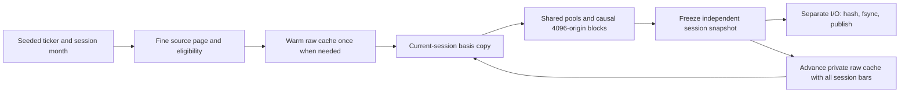

# Phase two: session shard generator and data contract

## Corporate-action empty-receipt correction (2026-11-10)

The previously reported July-25 coverage gap was traced to the extractor selecting
only `completed` publications. Canonical `covered_empty` receipts already exist
for those dates. The extension now accepts that status only with zero read/write/
failed counts, at least one provider page, no saturation, the SHA256 of canonical
empty `[]`, and an independent zero-row publication readback. Missing intervals
or incomplete/contradictory proofs still fail closed. This is verified empty
coverage, not an assumption that absent reference records imply no split.

Recorded: 2026-11-10 UTC. Current implementation baseline: **`1cb1bffe8`**,
committed/pushed and hash-synchronized as 709 Python files to native
`D:/TradingML/codes/bargpt-shards-1cb1bffe8`.

This is the consolidated record of the user's final shard-design clarifications,
the implemented sampled-v2 extractor, its validation and outstanding gates.
[PHASE1.md](PHASE1.md) records the shared market schema, quote fixes, encoder/
decoder checkpoint and phase-one corrected-data handoff. The shorter operational
overview is [phase2_ar_shards/README.md](phase2_ar_shards/README.md).

## 1. Status and scope

| Concern | Recorded state |
| --- | --- |
| Extractor format | `bargpt-phase2-ar-sampled-v2` |
| Implementation | Session-isolated blocks, shared context, once-only split basis, separate CPU/I/O pools |
| Focused validation | 51 tests passed locally and natively, including spawned CPU and actual publication/reader paths |
| Native source probes | Exact phase-one bar parity, including five 2026 AAPL frames; bounded page-size and short-session checks |
| Canonical 2026 schema/policy | Verified in the native read-only implementation probe |
| 2026 corporate actions | Coverage-proof gap starts **2026-07-25**; production preflight fails closed |
| Earlier source history | No canonical `events_2018` table or 2018 ordinal inventory found |
| Production dataset | Not launched; default target root did not exist at the implementation verification |
| Phase-two model training | Not launched; future-target/objective contract is not finalized |
| Monitoring | Remains paused at user request |

The coverage gap means missing **proof**, not proof that a split actually
occurred. It must not be converted into an assumed zero-action interval, hidden
by dropping later validation dates, or repaired from historical flatfiles.

The native evidence is under `phase2-ar-implementation-setup`, with local copies
under laptop `D:/TradingML/runtimes/bar_gpt/phase2-ar-implementation-setup`:

- `validation-session-1cb1bffe8.json`, seal
  `9a2a69a2895737ad2cffc653c885ba0ae9e191cec9c959556556b01694c04a75`;
- `source-session-proof-1cb1bffe8.json`, seal
  `469a86b04e97aad0ab7bf1d7b15ef26cf31f247faf304aa9341279ab1f5598a5`;
- `native-tests-1cb1bffe8.log`.

Do not mistake these bounded checks for a completed multi-TB release or GPU
training qualification. Current runtime state must be rechecked before launch.

## 2. Final requirements and superseded proposals

The user explicitly chose:

1. Retain the current broad **21,556-ticker** universe and **75/25
   liquid/less-liquid selected-origin exposure**.
2. Randomize ticker/month candidates from **2019-2025 training** and **2026
   validation**, with a **250 MB validation shard-data budget**.
3. Use **New York trading-session year** for that split, while storing all
   timestamps in UTC. The entire December 31 after-hours session stays in
   training even when its UTC closes fall on January 1.
4. Each training block has **exactly 4,096 consecutive observed 1s origins
   belonging to one 04:00-20:00 New York session**.
5. Warm at least **64 real completed bars per timeframe**. Historical context
   can come from earlier sessions; origins from those sessions cannot enter the
   current block. Skipped sessions can still supply later context.
6. Store shared unique frame bars plus causal references, not 4,096 repeated
   copies of each coarse context. No tokenizer stride is fixed in storage.
7. Keep one CPU owner across consecutive sessions of a sampled month, with
   in-memory cache reuse and a separate I/O publication pool.
8. Freeze a session's own split basis. Rebase later context without changing
   earlier saved sessions or applying the same split twice.

Earlier monthly-v1 defaults of 1,024/512/512/256/128 history bars and the old
phase-one 2024 split are **superseded** for this generator. So are the retired
stream's 256-decision geometry and fixed overlapping-view counts. The optional
CPU window helper's default stride 64 never meant nonoverlapping saved shards.

## 3. Historical v3 approach being reused

The retained v3 production model card records **25,674,006,806 origin
presentations**, a normally completed run, and production blocks of **4,096
origins**. Its coverage plan records **6,358,650,082 planned origins per outer
pass**, **300 tickers** and **25,200 ticker-month units**. Presentations include
repetition; they are not all unique market origins. The deleted old shards'
complete build time/physical size were not independently reconstructed from
that model card.

Relevant predecessor modules:

- [v3/direct_event_shards.py](../v3/direct_event_shards.py): owned chronological
  cache, calendar/intraday warmup, month-aligned canonical pages and ordered
  bounded prefetch;
- [v3/offline_shards.py](../v3/offline_shards.py): shared views, deduplication,
  block metadata, overlapped work and atomic publication;
- [v3/loader.py](../v3/loader.py): shared context and causal as-of indices.

The actual direct-event path used **calendar-month pages**, despite a
`clickhouse_query_days=7` config value. Arrow block size was **65,536 rows** and
configured prefetch was four pages. Its source default of 512 origins was not
the recorded production 4,096 setting.

The new extractor reuses that high-level shared-context structure, not v3's
50-feature projector, old condition exclusions, spread filter, targets or
calendar-validation assumptions. Its larger universe and quote-rich aggregation
are a different workload; v3's deleted 4-TB build timing is not a new ETA.

## 4. Source, plans and 2026 authority extension

Historical market reads use only `market_sip_compact.events_YYYY` and frozen
canonical ticker/day ordinal metadata. No provider acquisition, flatfile reads,
ClickHouse `file()` or server-global setting change is introduced.

[phase2_ar_shards/source.py](phase2_ar_shards/source.py) validates a sealed,
released corrected phase-one base and exact producer hashes, including the
shared action-adjustment implementation. It reuses
[phase2_shards/sql.py](phase2_shards/sql.py) only as a pure adapter around current
[shards/range_sql.py](shards/range_sql.py); the retired stream runner is not used.

All five views use the shared phase-one aggregate math and final v3 quote policy.
Do not derive coarser quotes by rolling up only saved trade-bearing 1s bars:
quote-only seconds can alter coarse opens, counts, invalidation and carry.
The source rules and quote repairs in [PHASE1.md](PHASE1.md) apply unchanged.

[phase2_ar_shards/inventory.py](phase2_ar_shards/inventory.py) adds a versioned
2026 metadata extension:

1. Verify canonical 2026 table policy, actual event/index part placement and
   schema parity with 2025.
2. Copy/hash the original 112 frozen ordinal partitions; freeze 16 additional
   2026 bucket partitions from the existing canonical index. Validate
   `next_ordinal-first_ordinal == event_count`.
3. Retain only the existing universe, recording excluded 2026 index rows rather
   than silently adding new 2026-only tickers. Freeze its 2026 activity classes.
4. Use native Polars grouping by ticker and **source session month**; freeze the
   seeded candidate order to `sample-units.parquet`, including its SHA256 and
   Polars version. This is not grouping by the UTC year of each event.
5. Extend the frozen parent action catalog with a complete chain of existing
   covered reference publications. Check read/write/failure counts, acquisition
   proof, unique action IDs and positive finite ratios. Conflicting parent
   evidence or an uncovered interval fails closed.

The implementation probe found 2026 ordinal coverage through source date
2026-10-02, but action coverage cannot be certified continuously past the gap
at 2026-07-25. A new data run must resolve that prerequisite explicitly.

Source table selection follows the frozen source-date/ordinal inventory; do
not infer table identity from UTC timestamp year alone. A December 31 NY source
session can include January 1 UTC timestamps. Redundant partition predicates
cover every intersecting UTC month without changing logical source bounds.

## 5. Exact stored arrays and meanings

[phase2_ar_shards/contract.py](phase2_ar_shards/contract.py) defines:

| Object | Layout |
| --- | --- |
| Frame set | 1s, 10s, 1m, 1h, regular-session daily; 100ms is not a saved phase-two view |
| `BAR` | `values Float32[18]`, `valid UInt8[18]`, `end_us Int64`; **98 bytes/row** |
| `ORIGIN` | `end_us Int64`, `latest Int64[5]`; **48 bytes/origin** |
| Logical block | `[4096]` origin records, all within one NY session |
| Published origins | `[number_of_blocks,4096]` structured array |
| Shared values of frame f | `[unique_saved_rows_f,18]`, with matching masks/clocks |
| Default history | `(64,64,64,64,64)` completed observations; configurable upward |

Channel ordering is exactly phase one's trade/bid/ask six-field families.
Values are market units on the publication's **session share basis**, not
normalized model tensors. Masks and actual UTC closes remain explicit.

The origin is the close of an actual eligible trade-bearing 1s bar, not every
wall-clock second. Missing clock buckets are not fabricated. A session with
4,096 observations can span much longer than 4,096 seconds if trading is sparse.

`latest[o,f]` is the last frame row whose completed close is `<= origin[o]`.
For 1s it must equal the origin's own close. All required history must exist;
forming bars and future rows in the same saved pool remain inaccessible through
these causal indices. Data can contain later completed bars for later origins
without making them valid inputs for an earlier origin.

## 6. One CPU owner's session lifecycle



[phase2_ar_shards/sampling.py](phase2_ar_shards/sampling.py) performs the work:

1. A seeded clock in a candidate month's observed source span chooses the first
   session to visit. Subsequent selected sessions in that month are chronological.
2. Read fine frames first. If a complete monthly source page proves every
   visited session has fewer than 4,096 observed 1s bars, emit explicit deferrals
   without coarse reconstruction or 64-day warmup. History is recorded as **not
   queried / null**, not zero observations. This shortcut does not filter inputs.
3. Otherwise obtain coarse bars and enough prior context. Older source pages
   request only still-needed frame groups; fine decoding stops when fine history
   is complete. No query is made per origin or per 64-bar window.
4. For each session with N >= 4,096 origins, choose a deterministic feasible
   starting index in `[0,N-4096]`. All following candidate origins are consecutive.
   This is seeded sampling, not uniform sampling over the entire market corpus.
5. Form each frame's shared warmup prefix, then append new unique bars. Vectorized
   `searchsorted(...,side='right')-1` supplies the causal references. Publish only
   full blocks with complete history. Record the unselected leading prefix,
   history deferrals, actual first eligible origin and partial final tail.
6. Independently advance the raw cache using **all** real bars of that session,
   including bars from a skipped/short session and its unselected prefix/tail.
   Start a fresh origin accumulator for the next day; never carry pending origins
   across the session boundary.

Short sessions must not combine: 3,000 observations on each of two days do not
make one 6,000-origin sequence eligible for a 4,096-origin block. They can still
provide the next session's hourly/daily/intraday history.

## 7. Split/reverse-split basis and immutability

All origins between 04:00 and 20:00 NY share phase one's executed-action basis
at that session's 04:00 boundary. Its UTC value is recorded as `basis_us`.

The worker keeps a small **unadjusted original-basis raw cache in RAM**. Before
forming a session snapshot, `rebase_cache` copies it and invokes the unchanged
phase-one `adjust_splits` math with the complete frozen ticker catalog and that
session basis. Earlier prices, including quote OHLC, multiply by
`split_from/split_to`; volume and displayed sizes use the inverse. Counts, masks
and clocks remain unchanged. Current-session bars already use that source basis.

Rebasing each copy from raw history avoids accumulating Float32 rounding across
successive corporate actions. Multiple forward/reverse actions are compounded
by the shared math. Future executions are not applied to earlier sessions.

The compiled session arrays own an independent frozen snapshot. Advancing the
private raw cache cannot mutate those arrays, even while an I/O thread still
has the snapshot queued. No blocking rewrite of yesterday's shard is needed.

The receipt binds `price_basis.session_date`, `basis_us`, the policy description
and `actions_hash`. Publication rejects origins outside that one session or a
different trading-session split. The operational writer requires this basis.
The production reader does not apply it again: its CPU window helper checks the
exact action hash and skips a second adjustment. It refuses to restore such a
snapshot as an unadjusted generation cache. Partial-month generation therefore
recomputes from canonical raw source rather than accidentally double-rebasing.

This uses one small prefix per session, shared across every block/origin in it.
Independent session prefixes can contain overlapping historical clocks on
different session bases; the contract does not claim global deduplication across
all sessions or repeat the full context 4,096 times inside one session.

## 8. Concrete coarse-frame example and GPU loading

Suppose the first origin is 04:00:01 NY, the last completed 10s bar is from the
previous eligible session, and the initial 10s pool has 64 rows:

| Origin close, shown in NY for illustration | Last 10s index |
| --- | ---: |
| 04:00:01 through 04:00:09 | 63, old completed bar from context |
| 04:00:10 through 04:00:19 | 64, new bar becomes available exactly at its close |
| 04:00:20 onward until the next completion | 65 |

Real records store the corresponding UTC microseconds, resolving DST with the
shared clock helper. There is no invented 10s bar during the overnight gap.
A dense single block needs roughly 64 warmup plus 4,096 new 1s rows and about
64 plus 409 newly completed 10s rows, not 4,096 repeated 10s rows. Exact counts
depend on start alignment and observed trading.

[phase2_ar_shards/storage.py](phase2_ar_shards/storage.py) provides
`ShardReader(directory).block(i)`. It verifies touched files once, mmaps only
intersecting parts, caches the required view slices and rebases indices.
`CachedBlock.context(origin,frame)` then performs no disk or ClickHouse read.
`MonthReader` is a name alias, not a weaker compatibility mode.

A future training reader can copy contiguous values/masks/clocks and the index
matrix to GPU, then gather causal 64-bar contexts there. Structured NPY fields
have record strides; use contiguous arrays before `torch.from_numpy` rather
than assuming a Float32 field is already Torch-compatible. The extractor itself
does not invoke the encoder or consume GPU resources.

## 9. Files, receipts, quotas and counters

```text
phase2-ar-sampled-v2/
  plan.json, provenance.json, execution.json
  inventory/plan/<year-bucket>.parquet and manifest.json
  sample-units.parquet
  catalog.sqlite                    # WAL, coordinator-owned
  shards/<ticker-hash>/<YYYY-MM-DD>/
    publication.json                # owned partial-publication identity
    view-<frame>-<start>.npy         # <=128 MiB array data per part
    origins.npy                     # [blocks,4096] origin records
    pending.npy                     # this session's partial tail only
    receipt.json
  selection-<count>-<digest>.parquet, selection.json
  progress.json, result.json
  timing.jsonl, monthly-timing.jsonl
  controller.lock, optional STOP
```

Publication writes/fsyncs arrays in an owned `.partial` directory, reads SHA256
and sizes, seals the receipt, then atomically renames the session directory.
Existing identity mismatches, foreign partials, mixed sessions and changed sealed
files fail; immutable receipts are not overwritten. The typed arrays are
vectorized, not per-origin copied training tensors.

The single coordinator owns SQLite `units`, `blocks`, `tails`, `deferrals` and
`completed_months`. It registers a receipt once, preserves selection IDs on
resume, and admits 3 liquid blocks for every 1 less-liquid block independently
for each split. Exact equal block length makes selected-origin exposure 75/25.
Extra complete blocks remain stored and counted but unselected. Merely visiting
three liquid month candidates does not enforce this quota.

For published candidate origins, the ledger checks:

```text
source_origins = 4096*candidate_blocks + pending_tail_origins
                 + warmup_deferred + boundary_tail_deferred
```

Separate deferral records account for unchosen short/history-deficient sessions;
the all-short fast path records `session_short_deferred` and unknown history
explicitly. Reported counters are sampled-corpus quantities, not unique SIP
messages, all raw origins in the universe, or model-training presentations.

The validation limit is **250,000,000 bytes**, a decimal upper shard-data budget,
not 250 MiB or exactly that many usable tokens. It includes saved context, NPY
headers, receipts and publication marker. Shared plan/catalog/log metadata is
outside it. Conservative reservation admits only whole session publications,
so realized size can be smaller. Unselected stored blocks also occupy that
budget; selected validation exposure must be reported separately.
The current implementation adds a conservative 1,000,000-byte overhead allowance
to each staged session reservation. It stops admitting new month work for a
split when less than that allowance remains or capacity rejections reach twice
the I/O worker count. Already computed sessions are still checked individually.
This explains why the realized size need not fill every remaining budget byte.

Candidate order/start choices are frozen. Concurrency, byte-cap admission and
completion order can affect which last sessions fit a fresh build and its
selection IDs. **Do not claim that seed alone makes independent capped rebuilds
bit-identical.** The realized sealed receipts and selection manifest are the
authority; resume inside the same root preserves them.

## 10. Workers, limits, progress and restart

| CLI setting | Default / meaning |
| --- | --- |
| `--workers` | 32 CPU processes; accepted range 1-61 for Windows ProcessPoolExecutor |
| `--io-workers` | 8 separate coordinator I/O threads; accepted range 1-16 |
| `--validation-lanes` | 4 query lanes during trainer validation/startup/stale status |
| `--history-bars` | `64,64,64,64,64`; each must be >=64 |
| `--seed` | `20261109` |
| `--query-memory-gib` | 8, maximum 8; one ClickHouse execution thread, 60-second query limit |
| `--reserve-memory-gib` | At least 64, plus requested active query budgets |
| `--reserve-disk-gib` | At least 150; coordinator also reserves queued publications |
| `--chunk-events` | 0 = calendar-month pages; positive = optional measured event budget |
| `--target-bytes` | 4,000,000,000,000 training shard-data bytes |
| `--validation-bytes` | 250,000,000 validation shard-data bytes |
| `--max-months` / `--only-ticker` | Bounded pilot scope; cannot declare a full release |

Source pages remain complete-session bounded. A single dense session can exceed
a positive event target; the setting is not permission to drop its events.
Memory/time exhaustion stays a visible failure, not a global limit increase or
an input truncation. The new path keeps v3 month alignment and 65,536-row Arrow
blocks, with global bounded query concurrency rather than four extra queries
per each of 32 CPU workers.

CPU owners warm/compile; I/O threads separately hash/fsync/publish. Staging is
bounded by outstanding CPU month results and twice the I/O worker count for
publication futures. Training guard is read-only and never signals the trainer.
It does not grant permission to restart a stopped trainer or weaken its guards.
The shared guard's full-admission branches also include controller completion
and fresh non-running child status; PID-creation inactivity is explicitly
checked in its early-stopped/stopped/failed branch, not every branch. Read
`phase2_shards/training_guard.py` and perform independent ownership verification
before any operational boundary action; admission is not a process certificate.

`progress.json` distinguishes active queries, outstanding CPU work, completed CPU
results waiting, running/queued I/O and staged session snapshots. Timings separate
admission wait, actual query work, total fetch/preparation, CPU compilation and
publication; repeated per-page query costs are not added once per session.
JSON console reports are emitted roughly every 15 seconds during coordination.

`STOP` drains owned work; it is never automatically cleared. A native ownership
lease prevents duplicate controllers. Keep-awake belongs to the coordinator
thread and is released on exit. Existing trainer/repair tasks and human STOPs
remain independent.

A monthly batch is marked complete only after every session publication/deferral
is acknowledged and sealed. Resume validates that record and its referenced
receipts/deferrals, then skips it without market queries. An interrupted or
capacity-limited partial month is recomputed from its frozen start; existing
session publications are reused. Raw generation cache is transient, not restored
from an already adjusted snapshot. Payload mutations fail hash checks on use.

## 11. Validation evidence and execution

The 51 focused local/native checks include default geometry, full causal history,
shared coarse rows, exact overnight closes, real process spawning/serialization,
separate I/O publication, restart without completed-month queries, budgets,
source-origin conservation, sealed inventory/selection, malformed data rejection,
split/reverse-split math, immutability, no double adjustment, short-session context
reuse, and December 31 after-UTC-midnight remaining in the training session.
CPU fixture orchestration is not a live GPU/model migration.

The bounded native source profile recorded:

| Probe | Result |
| --- | --- |
| Matched AAPL three-day arrays, 2M-event pages | 6 queries, 10.34s |
| Same source and arrays, calendar-month page | 2 queries, 9.29s; all five arrays byte-exact |
| AAPL 2026-01-02 | Five-frame bars `[18379,2771,648,16,1]`, exact values/masks/clocks against unpruned shared SQL |
| LARK 2020-05-08, 59 observed 1s bars | One fine query, no coarse/history queries, explicit short-session deferral; about 0.193s total fetch |

This is one matched live-load page comparison, not corpus throughput or an ETA.
No multi-TB build or exhaustive qualification was run. Older source-first packed
stream parity proves that historical repair pilot, not this replacement release.

Safe direct entry, from the committed immutable native snapshot:

```powershell
$env:PYTHONDONTWRITEBYTECODE='1'
Set-Location D:/TradingML/codes/bargpt-shards-1cb1bffe8
& C:/Users/Mehdi/miniconda3/envs/ml4t/python.exe -B research/bar_gpt/v5/run_phase2_ar_shards.py --source-revision 1cb1bffe8
```

This is preview, with no dataset writes or market queries. Full execution
additionally requires explicit `--execute`, a complete corrected base and a
valid 2026 extension. It currently fails at the documented action-coverage gap.
Use a fresh `D:/TradingML/runtimes/bar_gpt/phase2-ar-sampled-v2` root, never old
retired roots. Review resolved arguments, source authority, reserves and pilot
evidence before any production launch. Monitoring is not enabled by this command.

## 12. Retirement and model-design boundaries

The user explicitly cancelled the old stream generator, deleted its generated
data to free disk and removed phase-two quote repair from the execution queue.
`BarGPT-Phase2-Shards-v1` is disabled. Old `phase2-streams-v1` and
`phase2-pilot-v1` contain permanent STOP tombstones, not resumable datasets.
Deletion evidence records net **529,499,176,960 bytes** freed and 17,343 stream
directories removed, under
`quote-source-first-setup/phase2-retirement-20261109/deletion.json`.
No old root is a fallback or an input for this new build.

The unlaunched `phase2-ar-monthly-v1` prototype is also not this contract.
The existing source-first repair controller remains `--phase-one-only`; adding
this extractor does not put retired phase-two repairs back into its queue.

The intended downstream role is the phase-one encoder as a pretrained tokenizer,
with latent representations retained for later supervised and RL stages. The
stored contract deliberately does **not** finalize:

- latent forecasting versus end-to-end encoder/fusion/decoder training;
- historical token count/overlap, autoregressive target advance or horizon;
- cross-timeframe fusion masks/order and whether weights are frozen or finetuned;
- future target clock/availability handling, losses or evaluation targets;
- future price-reference metadata and inverse decoding into absolute prices.

A 512-dimensional encoder vector is not 512 tokens. Minimum 64-bar warmup gives
one initial 64-bar window per frame, **not sixteen disjoint windows**. If a model
needs 16 such 1s windows at its first scored origin, it needs 1,024 cached bars
or must wait until enough context accumulates inside the block. That eligibility
must be sealed by the eventual training reader; it is not silently promised by
the default cache.

Phase one's saved decoder outputs scaled continuous columns and also needs
time context and requested feature identities. Recovering absolute prices needs
the causal price reference, frozen activity stats and share basis. The current
preparation API does not persist an inverse-reference object with each latent.
Retaining decoder weights alone therefore does not finalize a leakage-free
future price decoder. Future quote availability and unconstrained predicted
OHLC/activity also need an explicit model/metric contract.

The manifests remain **`training_ready=false`**. Before training, fix the latent
input/target interface, context eligibility and target/session/year purge;
validate actual loader paths and decoder/normalization compatibility; resolve
the reference coverage gap; run bounded real-context and recovery pilots; and
publish a sealed realized selection. No phase-three/four or phase-two model
training is authorized merely by the existence of these source files.
